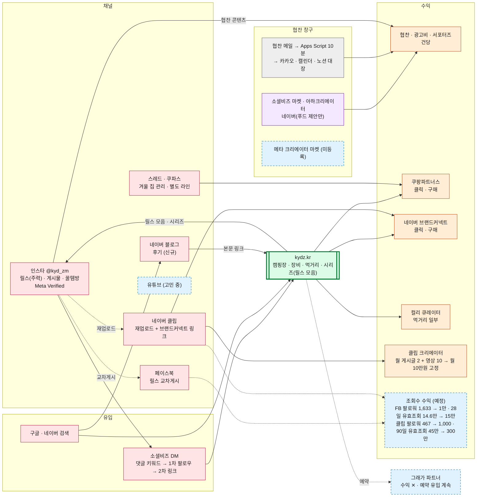
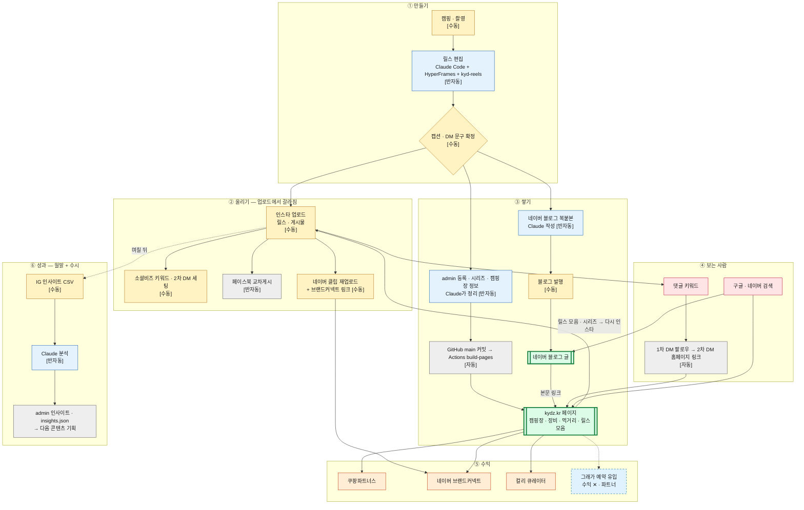
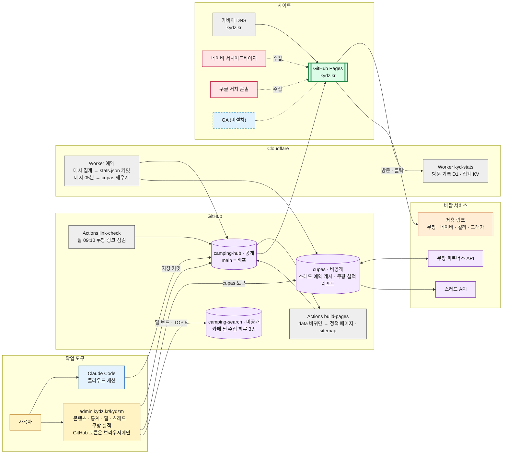

# 공대남자(@kyd_zm) 전체 운영 지도

> 261030 · 무엇이 수동이고 무엇이 자동으로 돌아서, 어떤 경로로 수익까지 가는가.
> 미리보기·편집: [`docs/pipeline.html`](pipeline.html) (같은 소스, 왼쪽 소스 / 오른쪽 그림). 비공개 저장소는 '무엇을 하는지'까지만 적는다 — 토큰·쿠팡 링크·수익 실적 숫자는 넣지 않음.

색: 노랑 사용자 · 파랑 Claude · 회색 시스템 자동 · 보라 정보 소스 · **초록(굵은 테두리) 쌓이는 자산** · 분홍 채널·유입 · 주황 수익 · 하늘 점선 파트너·미정

## 1. 전체 지도

## 2. 콘텐츠 1건 흐름

## 3. 홈페이지 연결 구조

## 확인 메모 (261030)

- 스레드(cupas): 하루 4개(09·12 정보, 18 정보+링크 1개, 22 질문형) + 토요일 20시 특가. Cloudflare Worker가 매시 05분에 깨움. 홈페이지로 유입되지 않는 별도 라인.
- 딜(camping-search): 하루 3번(08·16·23시) 수집 → admin 딜 보드·오늘의 딜 TOP 5. 꿀템방 게시는 수동.
- 성과 리포트: IG 인사이트 CSV를 수시로(정기는 월말) Claude에게 → admin 인사이트(`data/insights.json`). 노션 성과 기록은 260831 이후 갱신 없음.
- 협찬 메일 Apps Script: 동작 중(노션 협찬관리대장에 10분 주기 생성 흔적), 261030 기준 업체명 중복 0건.
- 사용 안 함(지도 제외): 사진 컬링(Cowork), kydbot, 타임라인 비주얼라이저, 댓글관리대장, 부계정.
- 조회수 수익 기준(261030): 페이스북 팔로워 1만·28일 유효조회 15만 / 네이버 클립 팔로워 1,000·90일 유효조회 300만.
